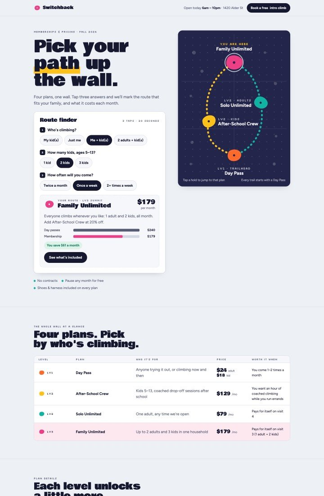
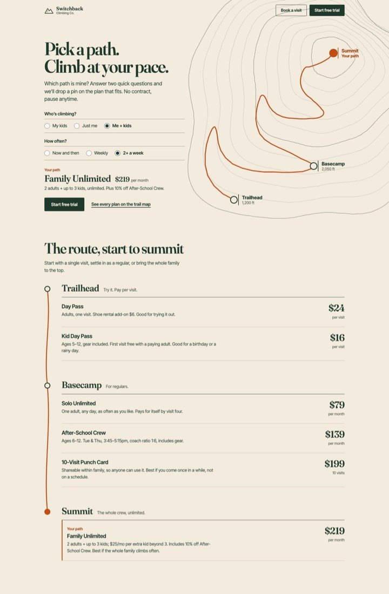
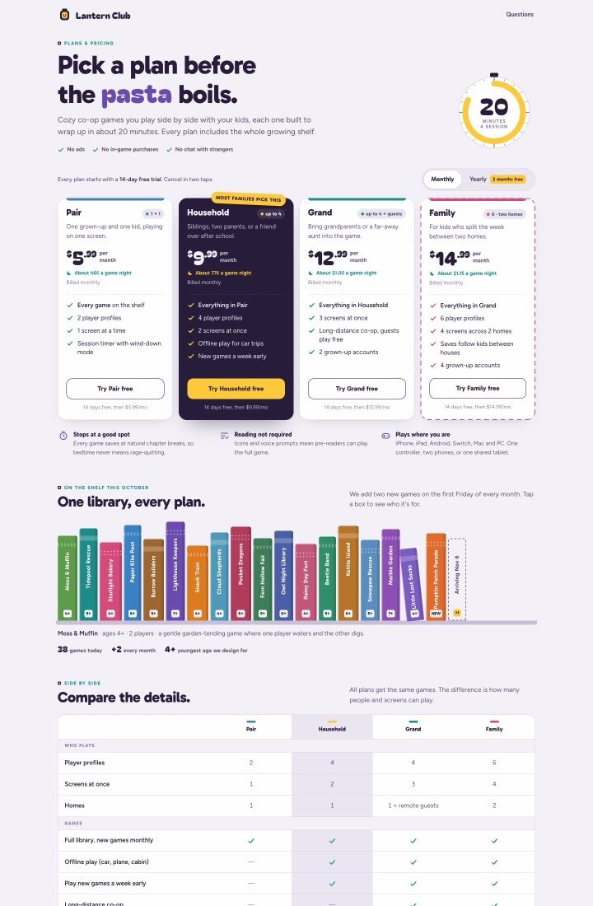
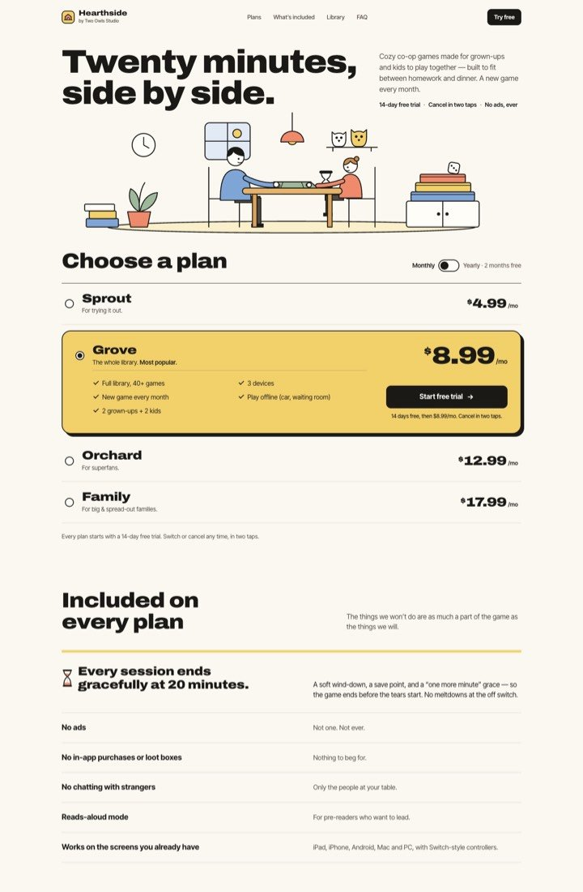
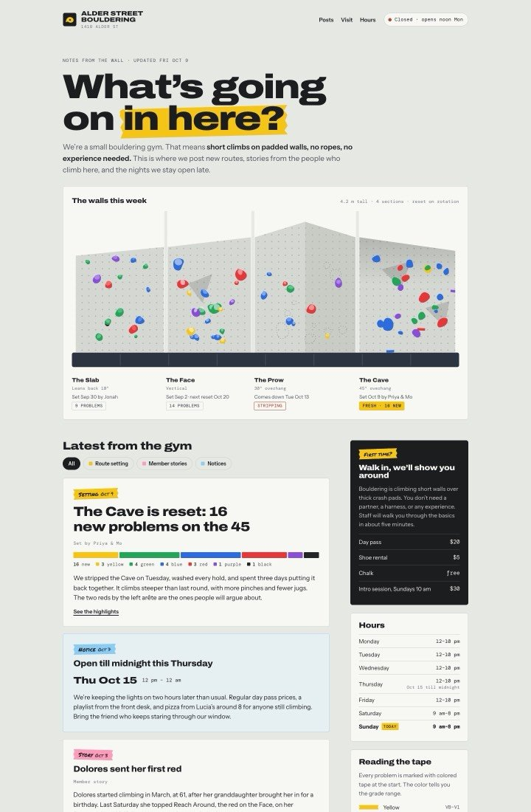
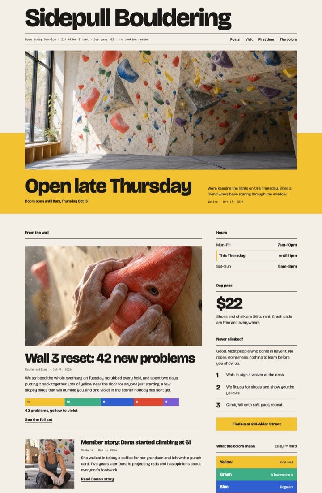
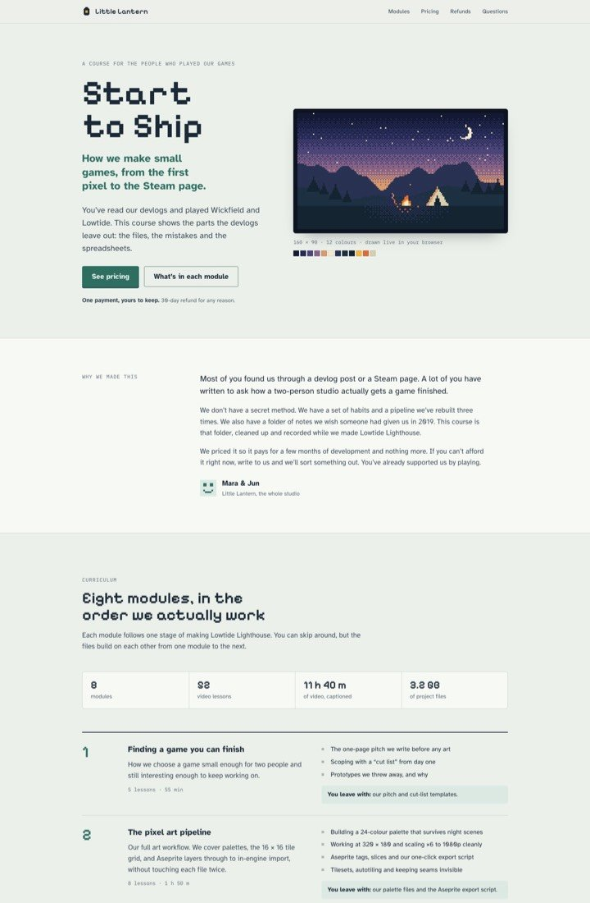
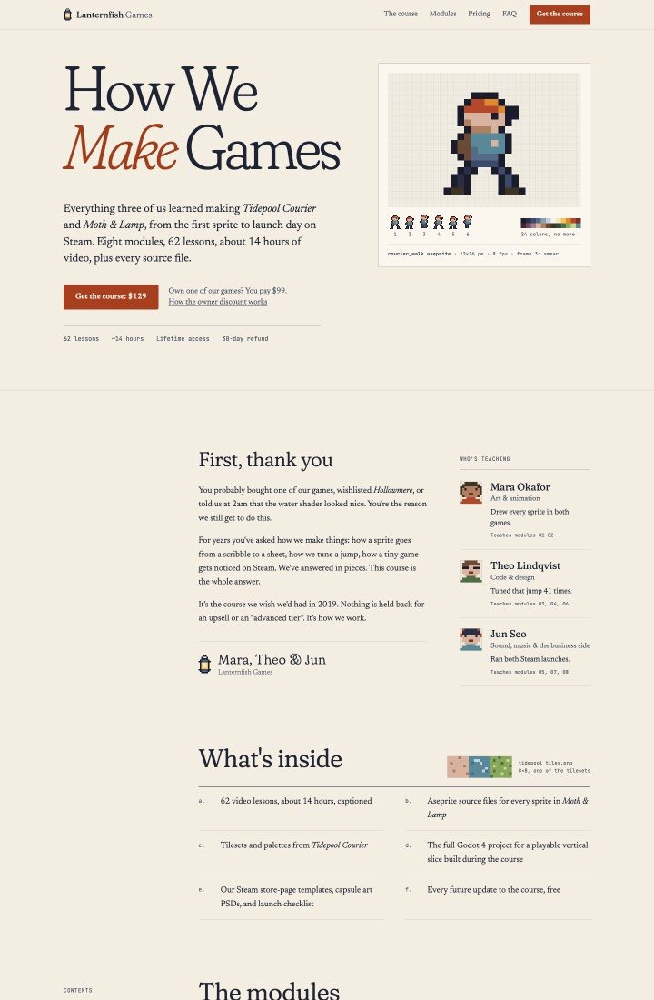

# wildling-design

## My Claude Code plugin (`/design-loop`) takes an HTML page, existing or new, to bolder places:

0. **Ambition gate** (plugin hook). When a prompt gives broad design direction ("build me a landing page for
   my productivity app"), Claude first asks "Want me to make this request more ambitious?" On yes, it
   rewrites the request around one vivid outside inspiration. Specific edits ("remove the footer", "make the
   logo bigger", "change the font to Inter") never trigger it. The classifier is regex, in
   `hooks/ambition_gate.py`.
1. **Onboard.** Asks for the page's purpose, audience, mood, must-keep content and moodboard, plus the
   **pass grade** (default 9/10), the round cap, the number of directions, and `enrich` (images, video, off).
2. **Discover.** Each direction starts from a random seed string (String Seed of Thought, Sakana AI) so the
   directions come out different. You pick one.
3. **Define.** Full-page redesign rounds. Each round a critic judges the page in a fresh `claude -p` process,
   seeing screenshots only: no code, no brief, and never the pass grade. It scores four criteria
   (composition, type, color, craft) against fixed anchors, and `loop.py` averages them. It also gets its own
   earlier findings on the winning line (`ledger.md`): it marks each one fixed, open or overshot, and it may
   not reverse a fixed one, so the critique can't flip-flop between rounds. Each fold is
   shot twice, on load and again after timed motion settles (`settle_ms`, default 8 s), so autoplay heroes and
   crossfades are judged by what a visitor actually sees. A version only
   becomes the new best if it
   - wins a side-by-side comparison against the current best in both A/B orders (a split verdict is
     position bias, so the best stays),
   - scores at least as high, and
   - passes a check that none of the original text, numbers or dates were lost, and that no API key leaked
     into the page.

   When the critique calls the page plain, rounds can **enrich** it (`scripts/media.py`): images through the
   Codex CLI on your ChatGPT plan; 3D/shader scenes Claude writes, live or recorded to video on a
   deterministic clock and chroma-keyed; generative video (Veo) if you add a key. Opus picks between
   candidates, comparing video by frame contact sheets. Real photos can be relit (`image --ref`, disclosed as
   AI-edited) and given one consistent ffmpeg look (`grade`), and each round warns when an asset is drawn
   more than 1.3× its own width, the blur no CSS can fix.
4. **Deliver.** The `polish` agent (fresh context) writes one subtraction candidate. It cuts elements that
   don't earn their place, sweeps the AI design tells (eyebrow labels, generic gradients, excessive
   containers, too many type styles…), and rewrites copy until the avoid-ai-writing detector finds no more
   issues than before.

The run stops when the score reaches the pass grade (`PASS`), hits the round cap (`STOP_MAX`), or goes 2 rounds
without a new best (`STOP_PLATEAU`: stalled or getting worse). On a plateau or the cap, you see the best page
and its round-by-round scores and choose: use it, or continue for 3 more rounds at a higher ambition
(`loop.py ambition`).

Method from Anshu Chimala's "How to turn your AI into a world-class designer" (Lenny's Newsletter,
2026-09-01).

## What it delivers

Same prompt, same model (Opus), same empty config; only the plugin differs. A Sonnet judge picked the better
page blind, 3 votes per matchup, A/B order randomized.

| | vanilla Claude | wildling |
|---|---|---|
| **Blind head-to-head** (5 prompts) | 1 | **4** |
| Avg time | 5.5 min | 36 min |
| Avg cost | $1.30 | $16.25 |

The one loss was a failed run, not a worse page ([details](#caveats)). Prompts are short and loose, and each
ends with "run the design loop, and don't stop to ask me questions".

### Vanilla vs. wildling, delivered

#### Climbing gym pricing page · "feel like a quest game" · busy parents

| vanilla | wildling |
|:-:|:-:|
|  |  |

Vanilla goes loud, with heavy display type and many widgets. Wildling carries the quest idea as a quiet trail
map (Trailhead → Basecamp → Summit) and a two-tap plan finder, easier to scan in the pickup line. [Full pages: vanilla](evals/img/design-loop/20261011-pr1shl-vanilla.jpg) ·
[wildling](evals/img/design-loop/20261011-pr1shl-wildling.jpg)

#### Family game subscription pricing · "premium on a tiny budget" · busy parents on a phone

| vanilla | wildling |
|:-:|:-:|
|  |  |

Vanilla ships four equal cards and a big comparison table; prices drop below the fold on mobile. Wildling
draws its own illustration (no asset budget needed) and shows prices straight away in a compact plan list. [Full pages: vanilla](evals/img/design-loop/20261011-n12ika-vanilla.jpg) ·
[wildling](evals/img/design-loop/20261011-n12ika-wildling.jpg)

#### Neighborhood bouldering gym blog · "playful without being childish" · local neighbors

| vanilla | wildling |
|:-:|:-:|
|  |  |

The "open late Thursday" note is the first thing you see in wildling's version, under a photo of the wall.
Vanilla's illustrated wall and card stack read as a template. [Full pages: vanilla](evals/img/design-loop/20261011-veedoe-vanilla.jpg) ·
[wildling](evals/img/design-loop/20261011-veedoe-wildling.jpg)

#### Indie-game course sales page · "calm and trustworthy" · existing loyal customers

| vanilla | wildling |
|:-:|:-:|
|  |  |

The brief: a thank-you to existing customers, not a hard sell. Wildling uses a warm serif, one accent color,
and a letter from the team right under the hero. Vanilla's pixel-font headings and two-tier pricing with a
discount banner feel more like a sale. [Full pages: vanilla](evals/img/design-loop/20261011-1dsqg0-vanilla.jpg) ·
[wildling](evals/img/design-loop/20261011-1dsqg0-wildling.jpg)

### The wildling journey: directions → delivered

Each run seeds three different directions (round 1), one is picked, and full-redesign rounds follow until a
stop condition. Shown: the first screen of each direction, then the delivered page. Scores are the blind
critic's, out of 10, for the picked direction.

#### Climbing gym membership page

| direction 1 · **picked** · 6.3 | direction 2 | direction 3 | **delivered** · 7.0 after 7 rounds |
|:-:|:-:|:-:|:-:|
|  |  |  |  |

Direction 1 starts as a hero with concentric rings and a static map key. By round 7 the rings are a
topographic route and the plan finder sits in the first screen.

<details>
<summary>Three more journeys</summary>

#### Family game subscription pricing page

| direction 1 | direction 2 | direction 3 · **picked** · 6.3 | **delivered** · 7.2 after 8 rounds |
|:-:|:-:|:-:|:-:|
|  |  |  |  |

#### Bouldering gym blog

| direction 1 · **picked** · 6.4 | direction 2 | direction 3 | **delivered** · 7.2 after 8 rounds |
|:-:|:-:|:-:|:-:|
|  |  |  |  |

#### Course sales page

| direction 1 · **picked** · 7.3 | direction 2 | direction 3 | **delivered** · 7.3 after 4 rounds |
|:-:|:-:|:-:|:-:|
|  |  |  |  |

</details>

### Caveats

- **It's a pilot.** Five prompts, one rep each, one judge model. 4–0–1 is a signal, not a benchmark.
- **The loss was a failed run**, not a worse page: on the docs-homepage prompt wildling produced no
  `index.html`, so vanilla won by default.
- **It costs about 12× as much and takes 6× as long** as one vanilla pass ($81 vs $6.51 total across the five).
- **The critic is strict.** Delivered pages scored 7.0–7.3 out of 10.

Every prompt, judge vote and the full run table: [evals/REPORT.design-loop.md](evals/REPORT.design-loop.md).

## Requirements
- Claude Code CLI, logged in (`claude auth login`). The critic runs headless.
- Node + Google Chrome. Screenshots use `npx playwright@1.63.0` with `--channel chrome`, so no browser
  download is needed.
- Python 3 (stdlib only).
- Media (optional): ffmpeg; Codex CLI signed in with ChatGPT (`npx -y @openai/codex@0.157.1 login`, run
  through npx, no install needed). Other providers go in a gitignored `.env.agents` in your project. Leave a
  provider blank if you don't have it. `python3 skills/design-loop/scripts/media.py doctor` shows what's usable.
- Copy gate (optional): the [avoid-ai-writing](https://github.com/conorbronsdon/avoid-ai-writing) skill at
  `~/.claude/skills/avoid-ai-writing`. Without it, the copy pass runs on its written rules only.

## Install
Clone, then load the repo as a plugin (needed for the ambition hook and the polish agent):
```bash
git clone https://github.com/zog-r/wildling-design-loop && cd wildling-design-loop
claude --plugin-dir "$PWD"
```
Skill only (no hook, no agent):
```bash
ln -s "$PWD/skills/design-loop" ~/.claude/skills/design-loop
```

## Usage
Interactive, in any project:
```
/design-loop
```
Headless, with a brief (fields in `skills/design-loop/SKILL.md`):
```bash
claude -p "Run the design-loop skill with --brief ./brief.json"
```

Run artifacts (seeds, variants, screenshots, critiques, `manifest.json`, `log.jsonl` with per-call cost) land
in `.design-loop/` inside the project you run it in.

## Cost
Critic calls run with lean flags, so each call pays about $0.02 of fixed overhead instead of loading your whole
Claude Code config. A full run (3 directions, 4–8 rounds, polish) averaged about $16 in the arena evals above
(before 0.4.0, which runs the side-by-side in both A/B orders: one more critic call per round).

## Test
```bash
python3 skills/design-loop/scripts/loop.py selftest
python3 hooks/ambition_gate.py selftest
python3 skills/design-loop/scripts/media.py selftest
```

## License
MIT. See [LICENSE](LICENSE).
