# Arena: vanilla vs wildling

5 seeded prompts × 1 rep(s). Generator `opus`, judge `sonnet` (3 blind votes, A/B order randomized per vote). Every contestant runs with no user settings, hooks, CLAUDE.md, or plugins; the only difference is its `--plugin-dir`. Every prompt is listed below, not a selection.

## Result: wildling vs vanilla (win–tie–loss for wildling)

**4–0–1**

### By axis

| axis | value | W–T–L |
|---|---|---|
| archetype | SaaS pricing page | 2–0–0 |
| archetype | docs homepage | 0–0–1 |
| archetype | online course sales page | 1–0–0 |
| archetype | personal blog home | 1–0–0 |
| audience | busy parents | 2–0–0 |
| audience | enterprise buyers | 0–0–1 |
| audience | existing loyal customers | 1–0–0 |
| audience | local neighbors | 1–0–0 |
| domain | climbing gym | 2–0–0 |
| domain | indie game studio | 2–0–1 |
| twist | it has to look premium on a tiny budget | 1–0–1 |
| twist | it should feel calm and trustworthy | 1–0–0 |
| twist | it should feel like a quest game | 1–0–0 |
| twist | it should feel playful without being childish | 1–0–0 |

### Every matchup

#### 20261011-1dsqg0 (rep 1): wildling **win**

> We're a small indie game studio and we're launching an online course on how we build our games, from pixel art pipelines to shipping on Steam. Build a sales page for it in index.html, aimed at people who already own our games and follow our devlogs, so it should feel like a thank-you to them, not a hard sell. Keep the vibe calm and trustworthy: clear pricing, what's in each module, a refund promise, no countdown timers or pushy stuff. Make it look world-class: run the design loop, and don't stop to ask me questions, pick sensible defaults.

Judge: B reads as a refined, editorial thank-you. It has a warm serif and a single accent colour. It also has an honest wishlist chart, a "who it's for / not for" section, and a plain refund promise next to the pricing. A is competent, but its pixel-font headings, dense module lists and two-tier pricing with a discount banner feel more generic and more like a sale.; A feels like a calm, editorial thank-you, with a warm serif design, one clear $129 price with the owner discount, a plain refund promise and an honest wishlists section. B is competent, but its pixel font, "Choose an option" CTA and two-tier pricing read as more generic and more sales-driven.; A's warm editorial serif design reads as a calm, personal thank-you. It has a clear single-price card, a visible refund promise and an honest wishlist chart. B's pixel-font headings and two-tier pricing with a discount banner feel more generic and slightly more sales-driven.

| vanilla | wildling |
|---|---|
| 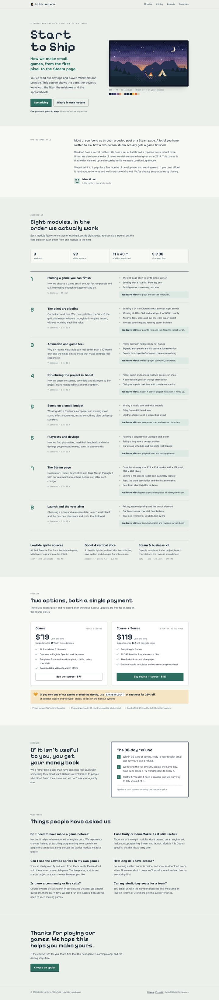 | 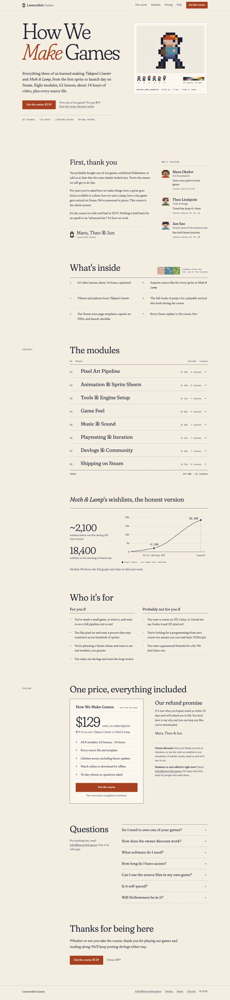 |

How wildling got there (first screen of each explored direction, critic score /10):

| d1 · 7.3 | d2 · not picked | d3 · not picked | delivered · 7.3 after 4 rounds |
|---|---|---|---|
| 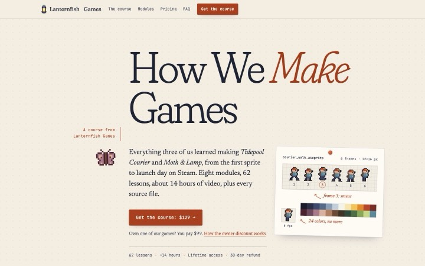 | 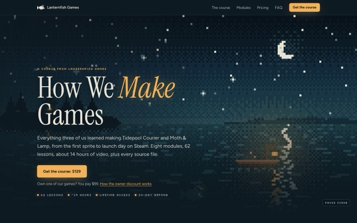 | 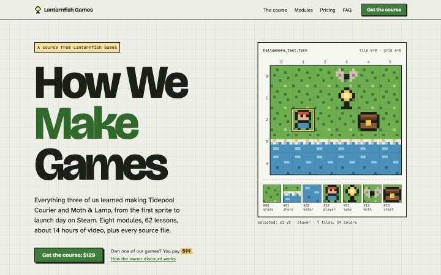 | 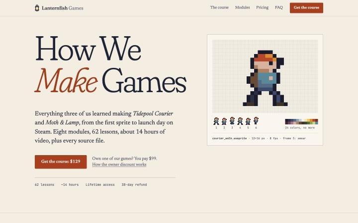 |

#### 20261011-n12ika (rep 1): wildling **win**

> We're a two-person indie game studio and we need a pricing page for our family game subscription, which gives you a growing library of cozy co-op games parents can play with their kids in 20-minute sessions. It's aimed at busy parents who want to compare plans fast on their phone between school pickup and dinner, so keep it scannable with like three tiers and a family plan. We have basically zero budget for assets or illustrations, but it still needs to feel polished and premium, not like a cheap template. Save it as index.html in this folder with all the CSS and JS inline. Make it look world-class: run the design loop, and don't stop to ask me questions, pick sensible defaults.

Judge: B has a distinctive, polished look with a custom illustration, strong typography and a clear tier list that shows prices straight away on mobile. It also stays close to the "like three tiers and a family plan" brief. A is a busy four-card template with a detail-heavy comparison table, and its mobile first screen is a long stack that buries the prices.; B reads faster and looks more premium. It has three tiers plus a family plan in a compact list, with the pricing visible on the first mobile screen. A's four dense cards push the pricing below the fold on mobile. B also pairs a bold, editorial look with custom line illustrations that were made without any asset budget.; B has a clear editorial look with a bold hero illustration. Its plan list is easy to scan on a phone, and it shows three tiers plus a family plan with the popular one highlighted. A is dense and busy, with four equal cards, many badges and a large table, and its mobile first screen is mostly stacked card chrome. That reads as more template-like.

| vanilla | wildling |
|---|---|
| 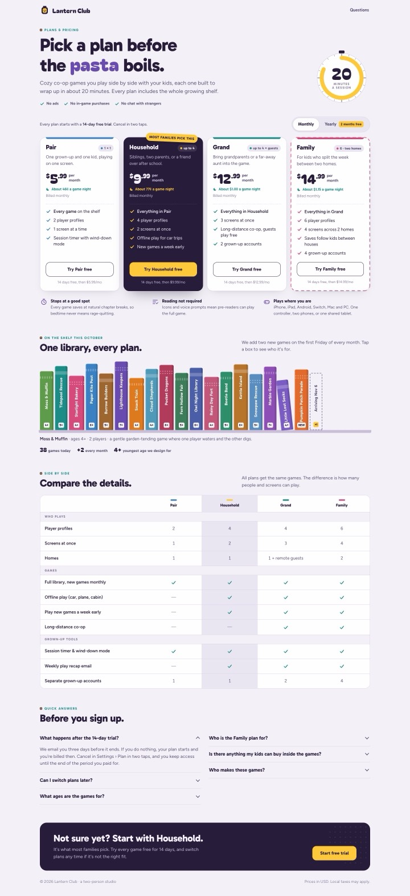 | 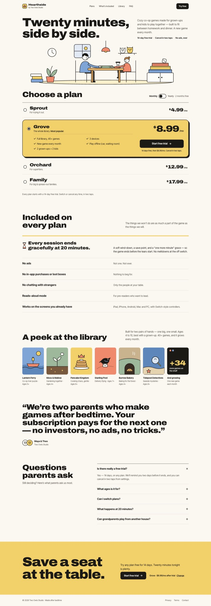 |

How wildling got there (first screen of each explored direction, critic score /10):

| d1 · not picked | d2 · not picked | d3 · 6.3 | delivered · 7.2 after 8 rounds |
|---|---|---|---|
| 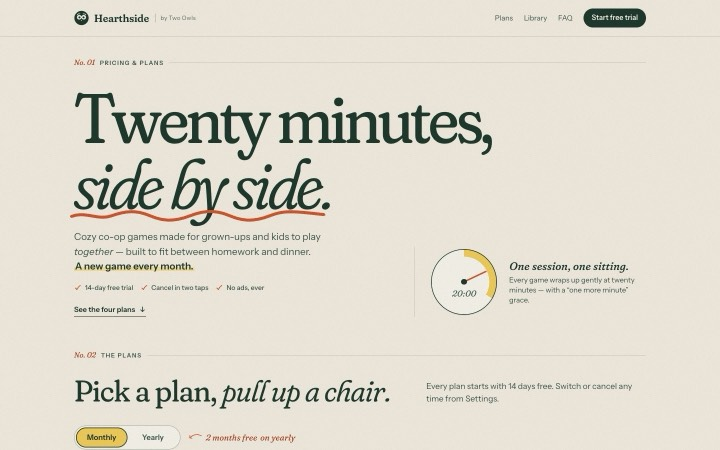 | 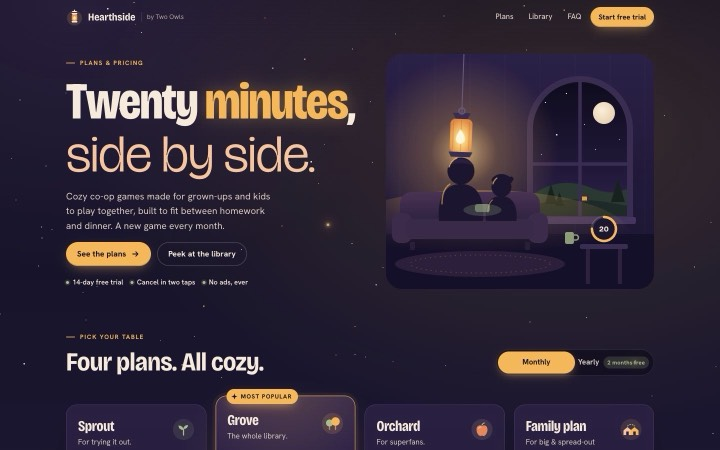 | 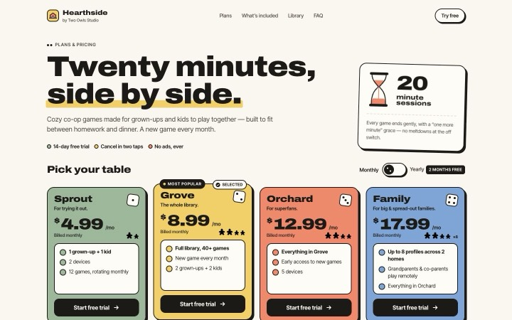 | 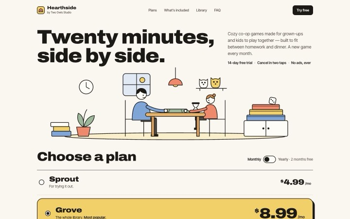 |

#### 20261011-pr1shl (rep 1): wildling **win**

> Can you build a single-page index.html (inline CSS/JS, no build step) for our climbing gym's membership pricing page? It's mostly aimed at busy parents trying to figure out which plan works for their family: kids' after-school sessions, a parent day pass, the family unlimited tier, that kind of thing. I'd love it to feel like a quest game, with tiers as levels or paths to choose and some sense of progression, while still being dead simple to scan when you've got two minutes in the school pickup line. Make it look world-class: run the design loop, and don't stop to ask me questions, pick sensible defaults.

Judge: B pairs a calm trail-map metaphor with a clear Trailhead→Basecamp→Summit progression, a simple two-question plan finder, and a real photo, so it's quick to scan in the pickup line. A's loud, neo-brutalist game styling and repeated plan lists feel more generic and busy.; B has a refined, restrained look with a trail-map theme that carries the quest and progression idea (Trailhead → Basecamp → Summit). The route list is easy to scan and the cost comparison is clear. A's heavy display type, bright colors and dense game-style widgets feel overdone and less polished.; B carries the quest-game idea through the whole page, with levels, a route finder, a "you are here" map and level-by-level unlock cards. It stays easy to scan, with side-by-side plan cards and a comparison table. A is polished and calm, but it reads as a generic editorial page with a trail metaphor, and it has less sense of progression.

| vanilla | wildling |
|---|---|
| 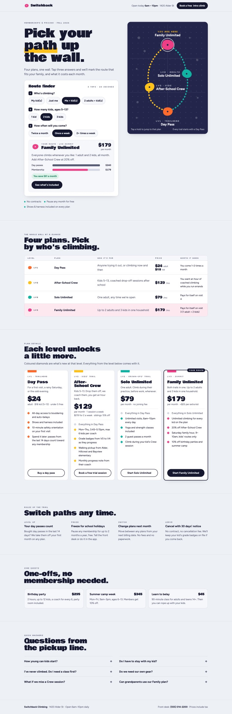 | 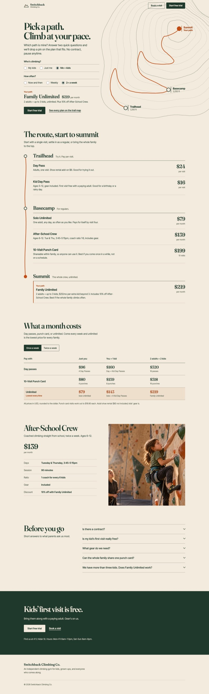 |

How wildling got there (first screen of each explored direction, critic score /10):

| d1 · 6.3 | d2 · not picked | d3 · not picked | delivered · 7.0 after 7 rounds |
|---|---|---|---|
| 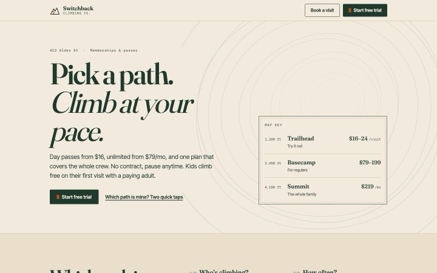 | 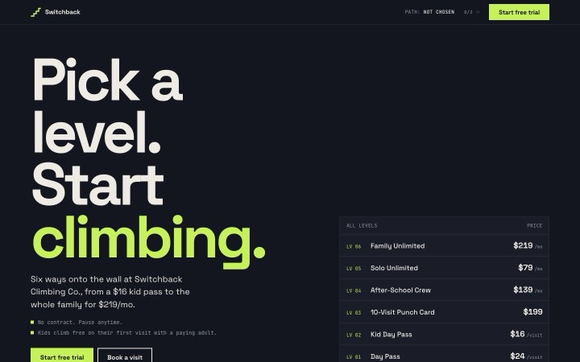 | 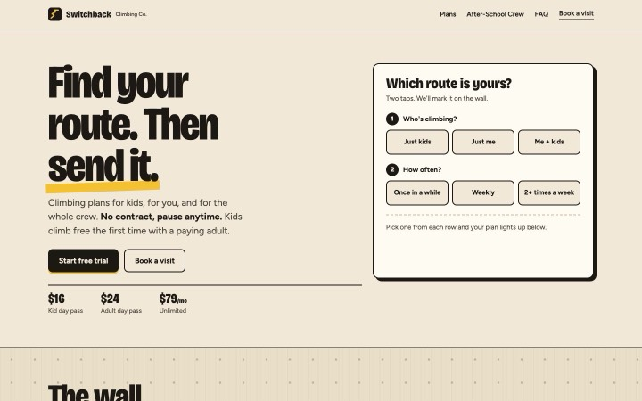 | 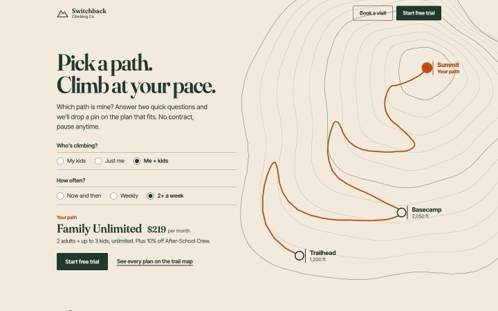 |

#### 20261011-veedoe (rep 1): wildling **win**

> I run a small bouldering gym in our neighborhood and I want a blog-style homepage where I post route-setting updates, member stories, and the occasional "hey, we're open late Thursday" note. It's mostly for people who live nearby, some climb and some just walk past our window and wonder what's going on inside. It should feel fun and a little playful, like chalky hands and bright holds, but not cartoonish or like a kids' party venue. Make it look world-class: run the design loop, and don't stop to ask me questions, pick sensible defaults.

Judge: A uses real, evocative photography (chalky hands, bright holds, a window onto the street) with a bold editorial layout and a clear "Open late Thursday" banner. It feels polished and human, while B's illustrated wall and stack of card-style posts look more generic and template-like.; A uses real, evocative photography and a bold editorial layout. Its yellow "Open late Thursday" banner is the first thing you see, and the chalk-and-holds mood is playful without being cartoonish. B is competent, but its illustrated wall and stack of tinted cards feel more templated and AI-generated, and its feed is more cluttered.; A has a confident editorial layout with real photography, a bold yellow "Open late Thursday" banner and a clear hierarchy. It feels playful but grown-up, whereas B's illustrated wall and card stack with tape labels is busier and reads more like a template.

| vanilla | wildling |
|---|---|
| 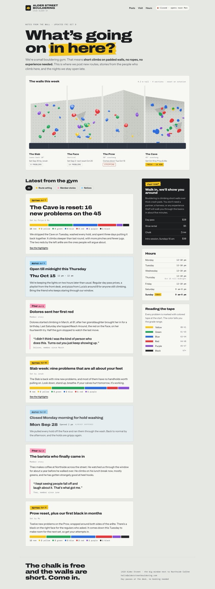 | 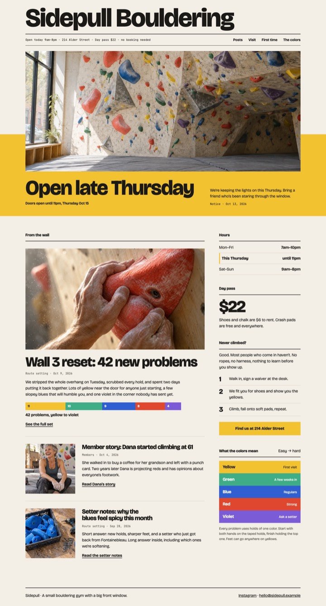 |

How wildling got there (first screen of each explored direction, critic score /10):

| d1 · 6.4 | d2 · not picked | d3 · not picked | delivered · 7.2 after 8 rounds |
|---|---|---|---|
| 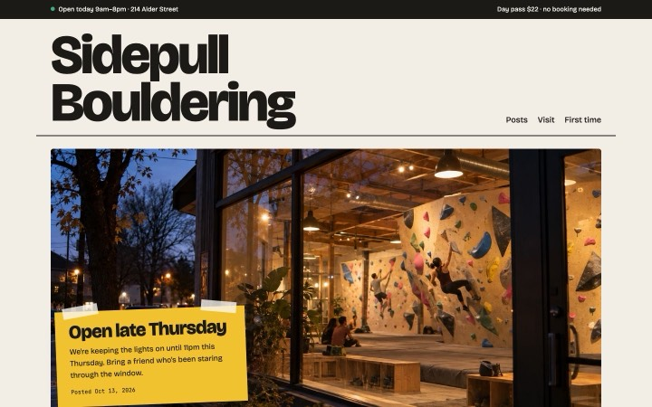 | 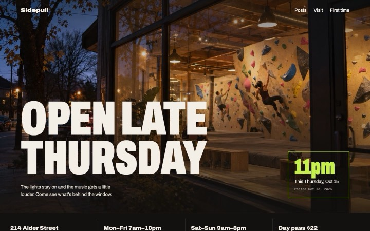 | 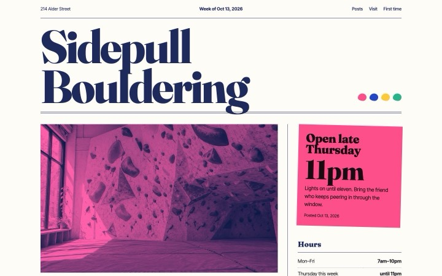 | 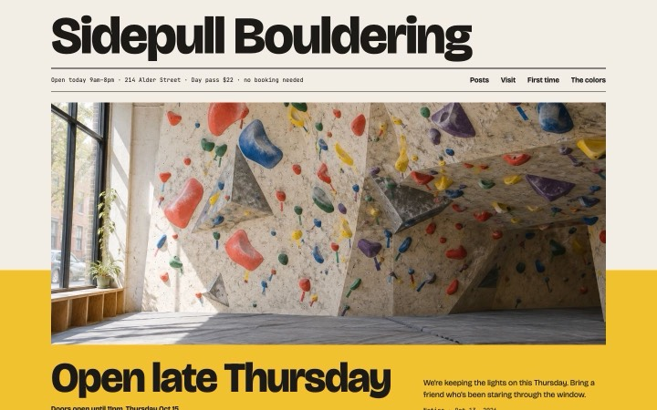 |

#### 20261011-y8ttol (rep 1): wildling **loss**

> We're a five-person indie game studio that licenses our in-house engine and tooling SDK to bigger companies, and I need a docs homepage saved as index.html (inline CSS/JS, no build step) that points people to getting started, API reference, guides, and support. The readers are enterprise buyers and their technical evaluators, so it has to feel as polished and trustworthy as the big vendors even though we have basically no budget: no stock photo subscriptions, no paid fonts, nothing fancy to host. Make it look world-class: run the design loop, and don't stop to ask me questions, pick sensible defaults.

Judge: no page produced

| vanilla | wildling |
|---|---|
| 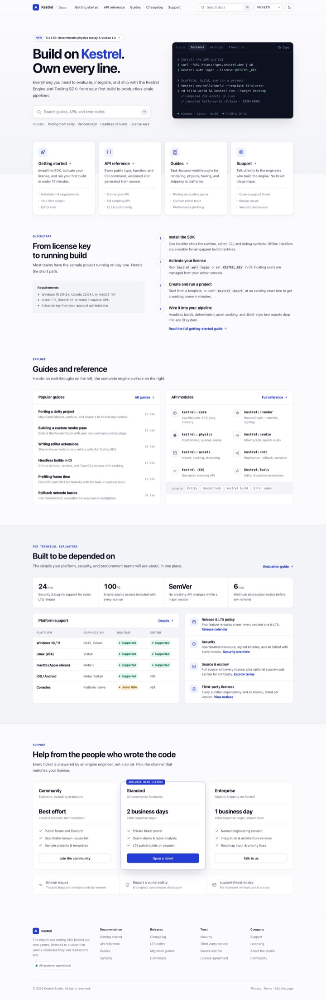 | _no page_ |

## Cost and time

Cost includes subprocess spend the tool logs (`cost_logs` in the config).

| contestant | runs | avg time | avg cost | total cost | errors/timeouts |
|---|---|---|---|---|---|
| vanilla | 5 | 328s | $1.30 | $6.51 | 0 |
| wildling | 5 | 2133s | $16.25 | $81.23 | 0 |

_Generated 2026-10-12T05:19:58+00:00 by arena. Prompts frozen in `evals/prompts/design-loop/`; re-run with `arena.py run --repo . --suite design-loop`._
