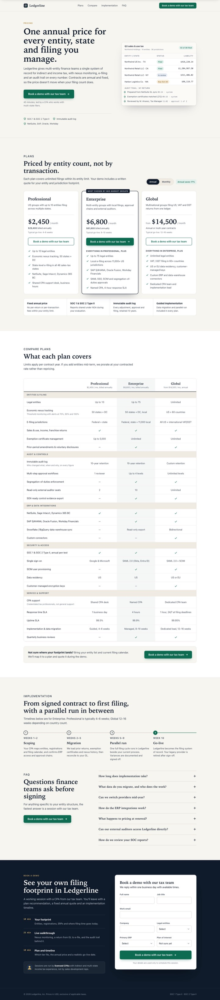
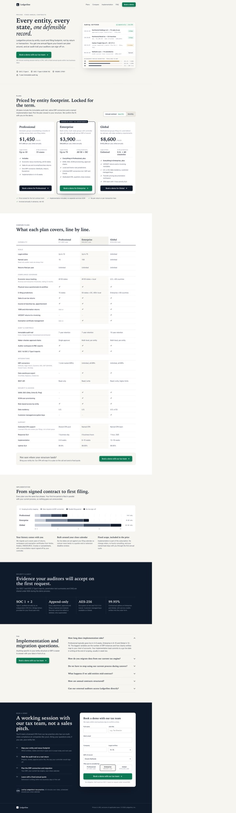
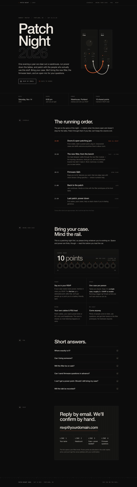
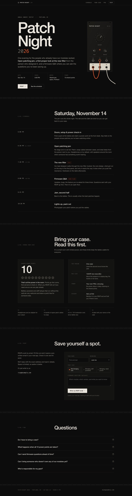
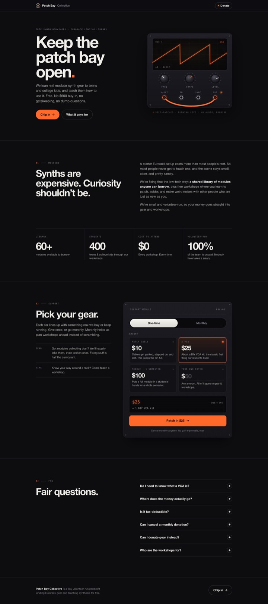
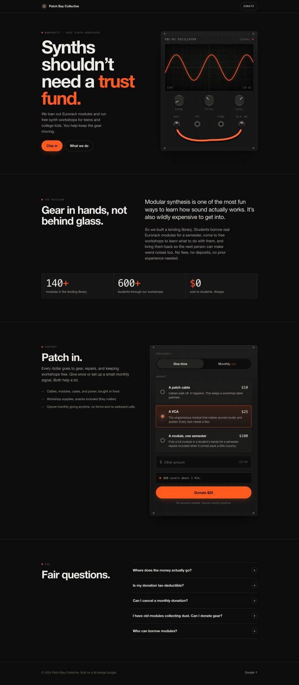
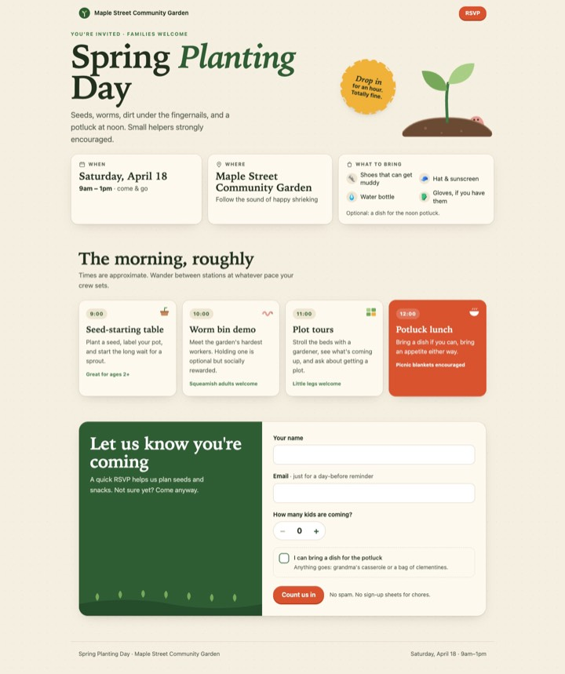
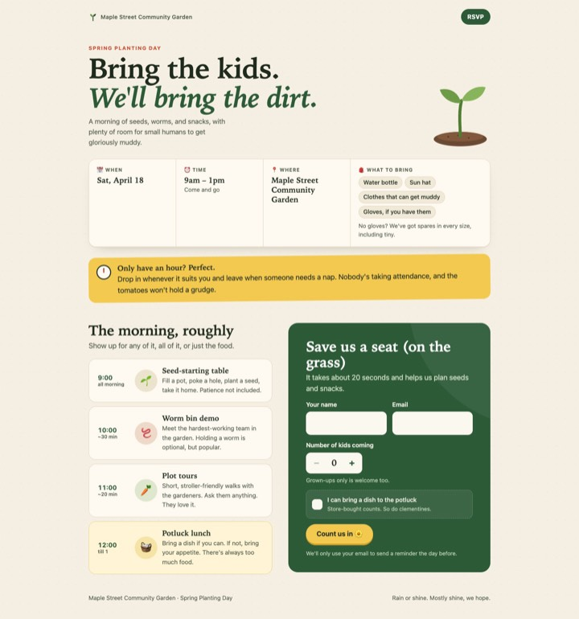
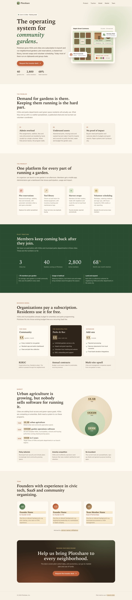
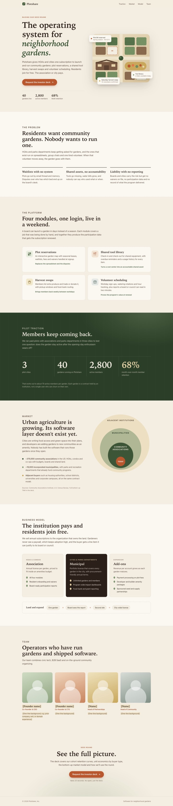

# Arena: vanilla vs wildling

5 seeded prompts × 1 rep(s). Generator `opus`, judge `sonnet` (3 blind votes, A/B order randomized per vote). Every contestant runs with no user settings, hooks, CLAUDE.md, or plugins; the only difference is its `--plugin-dir`. Every prompt is listed below, not a selection.

## Result: wildling vs vanilla (win–tie–loss for wildling)

**4–0–1**

### By axis

| axis | value | W–T–L |
|---|---|---|
| archetype | SaaS pricing page | 1–0–0 |
| archetype | event microsite | 1–0–1 |
| archetype | nonprofit donation page | 1–0–0 |
| archetype | product launch page | 1–0–0 |
| audience | Gen Z | 1–0–0 |
| audience | busy parents | 1–0–0 |
| audience | enterprise buyers | 1–0–0 |
| audience | existing loyal customers | 0–0–1 |
| audience | investors | 1–0–0 |
| domain | community garden | 2–0–0 |
| domain | modular synths | 1–0–1 |
| domain | tax accounting | 1–0–0 |
| twist | it has to look premium on a tiny budget | 1–0–1 |
| twist | it needs a strong single call to action | 2–0–0 |
| twist | it should feel playful without being childish | 1–0–0 |

### Every matchup

#### 20261010-gp2ozy (rep 1): wildling **win**

> Build me a pricing page for our tax accounting platform, Ledgerline, and save it as index.html in this folder with all CSS and JS inline, no build step and no external images (use CSS or inline SVG for any visuals). The audience is enterprise finance leaders, meaning CFOs, tax directors and controllers at companies with multi-entity, multi-state filing needs. They care about audit trails, SOC 2, ERP integrations and predictable annual contracts, not cute startup copy. Show three tiers (Professional, Enterprise, Global) with an annual/monthly toggle, a feature comparison table covering things like entity limits, nexus tracking, e-filing jurisdictions, SSO and dedicated CPA support, plus a short FAQ about implementation timelines and data migration. The whole page should drive toward one action, "Book a demo with our tax team." Don't scatter competing buttons like "Start free trial," "Contact sales" and "Learn more." Every tier and section should funnel into that single CTA, and it should stay visually dominant, including a sticky version once the user scrolls past the hero.

Judge: Design B has a visible text rendering bug on mobile ("works withmulti-state filers" — missing space), a flaw A doesn't share, while both are otherwise comparably polished and on-brief.; B pairs the same clean single-CTA system with richer, more audience-specific substance (deeper compliance/ERP comparison table, a SOC/audit "evidence" section, and a per-tier implementation timeline chart) that better matches the enterprise tax-finance audience's priorities.; B's hero audit-trail mockup shows concrete, realistic multi-entity filing data (entities, states, liabilities, review status) that lands the "audit trail" pitch more convincingly to a CFO/tax-director audience than A's more abstract card, while both otherwise execute the single-CTA structure equally well.

| vanilla | wildling |
|---|---|
|  |  |

#### 20261010-s8v85r (rep 1): wildling **loss**

> Can you build me a single-page site as index.html in this folder (all CSS and JS inline, no build step, no external images) for our annual customer meetup, "Patch Night 2026," which we're hosting for people who already own our Eurorack modules — it's Saturday, November 14 at a small warehouse space in Portland, doors at 6pm, with an open patching jam, a short talk from our lead designer about the new filter module, and a firmware Q&A. The audience is our regulars, so skip the "what is modular" explainer and speak to them like insiders: include a schedule, a "bring your case" note with power/space limits (we'll have 10 shared power points), an RSVP section that's just a mailto link since we don't have a form backend, and a short FAQ. We have basically no budget and no photos, so I need it to feel premium purely through typography, spacing, and maybe some subtle CSS-drawn patch-cable or panel-graphic details — think boutique hardware brand, dark and restrained, not a cheesy rave flyer.

Judge: B's RSVP section is a true mailto link with plain-text guidance on what to include, matching the "no form backend" request, while A builds a fake multi-field form UI (dropdowns, radios, textarea) that misleadingly looks like it submits to a backend.; A keeps the RSVP section an honest, simple mailto link as requested, while B builds a multi-field pseudo-form (name input, dropdowns, radio buttons, textarea) that misleadingly looks like a backed form and feels overbuilt against the "no form backend" constraint.; B's RSVP section is a clean mailto-style card true to "just a mailto link, no form backend," while A builds an elaborate fake form (dropdowns, radio buttons, textarea) that implies backend interactivity the request explicitly said didn't exist.

| vanilla | wildling |
|---|---|
|  |  |

#### 20261010-u65z7s (rep 1): wildling **win**

> I run a tiny nonprofit called Patch Bay Collective that loans out Eurorack modules and runs free synth workshops for teens and college kids, and I need a donation page built as a single index.html in this folder with all CSS and JS inline, no frameworks, no build step, and no external images (use CSS gradients, SVG drawn inline, or pure type for visuals, maybe a little animated patch cable or oscillator waveform as the hero). We have basically zero design budget but I want it to feel like a boutique synth brand's site, not a church bake sale: think tight typography, dark panel aesthetic with knob/jack details, restrained accent color, generous spacing. The audience is mostly Gen Z so keep the copy casual and honest, no corporate guilt-trip tone, and make it great on phones first. It needs a short mission blurb, preset donation tiers framed like gear ($10 "patch cable", $25 "a VCA", $100 "a full module loaned out for a semester") plus a custom amount, a monthly/one-time toggle, a few quick impact stats, a small FAQ accordion, and a donate button that just shows a thank-you state for now since we haven't hooked up payments yet.

Judge: A implements the required "preset tiers plus a custom amount" clearly with an explicit "Other amount" input field, while B's fourth tile ("Your own patch $50") looks like just another fixed preset rather than a true custom-amount entry.; A implements a real custom-amount input field as the spec requires, while B's "Your own patch $50" tile just looks like a fixed preset despite claiming "any amount," making its custom-amount option unclear.; B's copy feels more specific and authentic to the synth/Gen-Z voice (e.g. "no dumb questions," "Your own patch" custom tier styled as gear, "Do I need to know what a VCA is?" FAQ), giving it a slightly more boutique, less generic feel than A while both are polished and faithful to the brief.

| vanilla | wildling |
|---|---|
|  |  |

#### 20261010-uqtmnd (rep 1): wildling **win**

> Can you build me a single-page site for our community garden's spring planting day, saved as index.html in this folder with all the CSS and JS inline and no external images (use CSS shapes, emoji, or inline SVG if you need visuals)? It's Saturday, April 18, 9am–1pm at the Maple Street Community Garden, and we're trying to get more families with young kids to come, so the page needs to work for busy parents skimming on their phones: date, time, location, and "what to bring" should be visible right away, plus a short schedule (seed-starting table, worm bin demo, plot tours, potluck at noon), a note that drop-in for an hour is totally fine, and a simple RSVP form with name, email, number of kids, and a checkbox for "I can bring a dish" that just shows a friendly confirmation message on submit. I want it to feel playful and warm, maybe some bouncy hover states or a little sprouting animation, but not cartoonish or babyish; think nice grown-up design with a sense of humor, not a kindergarten flyer.

Judge: B's copy and layout show more wit and polish throughout (headline, microcopy like "tomatoes won't hold a grudge") while staying just as clean and ungimmicky as A.; B's schedule section uses distinct cards with witty per-event tags and a highlighted potluck card, plus a more dynamic hero (sticker badge over the sprout) and a decorative RSVP panel, giving it a more intentional, studio-level finish than A's flatter list/banner treatment.; A keeps consistent branding and layout polish across breakpoints (e.g., full "Maple Street Community Garden" header intact on mobile), while B's mobile header truncates to just "Community Garden," a small but noticeable responsive inconsistency.

| vanilla | wildling |
|---|---|
|  |  |

#### 20261010-v98950 (rep 1): wildling **win**

> Can you build me a single-page launch site for Plotshare, our new platform that lets neighborhoods spin up and run community gardens (plot reservations, shared tool library, harvest swaps, volunteer scheduling), and save it as index.html in this folder with all CSS and JS inline, no build step, and no external images — use CSS shapes, gradients, or inline SVG for any visuals. The audience is seed-stage investors, not gardeners, so the copy should lean on the business case: market size for urban agriculture, our pilot traction (3 cities, 40 gardens, 2,800 active members, 68% month-over-month retention), the subscription model for HOAs and municipalities, and the team. Everything on the page should funnel toward one clear call to action, "Request the investor deck," with a single prominent button that appears in the hero and repeats at the bottom, opening a simple inline form (name, firm, email) that shows a confirmation message on submit without actually sending anything. Keep it warm and earthy but polished enough that it doesn't feel like a hobby project, and make sure it looks good on mobile.

Judge: B fills in real market-sizing data and avoids the unresolved "$X.XB / $XXXM / $X" placeholder numbers that appear throughout A's market and pricing sections, making it feel more finished.; A ships multiple glaring unfinished placeholders ("$X" pricing/TAM figures, "advisor names / affiliations" text) that would be embarrassing to investors, while B fills in plausible real numbers and polish throughout.; B exposes raw unfilled placeholder text like "$X / garden / month" and "$X.XB / $XXXM / $XXM" in its business model and market sections, which looks broken and unfinished for investor-facing copy, while A's content reads as polished prose throughout.

| vanilla | wildling |
|---|---|
|  |  |

## Cost and time

Cost includes subprocess spend the tool logs (`cost_logs` in the config).

| contestant | runs | avg time | avg cost | total cost | errors/timeouts |
|---|---|---|---|---|---|
| vanilla | 5 | 257s | $1.00 | $4.99 | 0 |
| wildling | 5 | 247s | $0.93 | $4.63 | 0 |

_Generated 2026-10-12T05:17:08+00:00 by arena. Prompts frozen in `evals/prompts/`; re-run with `arena.py run --repo .`._
